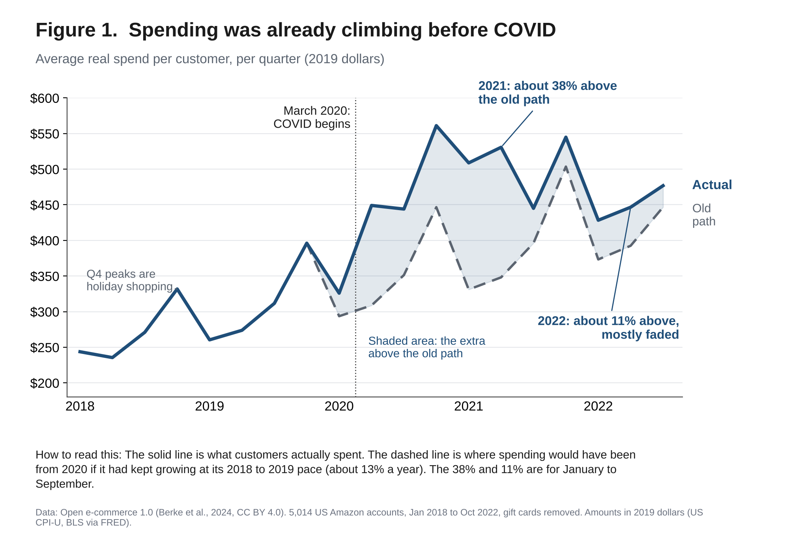
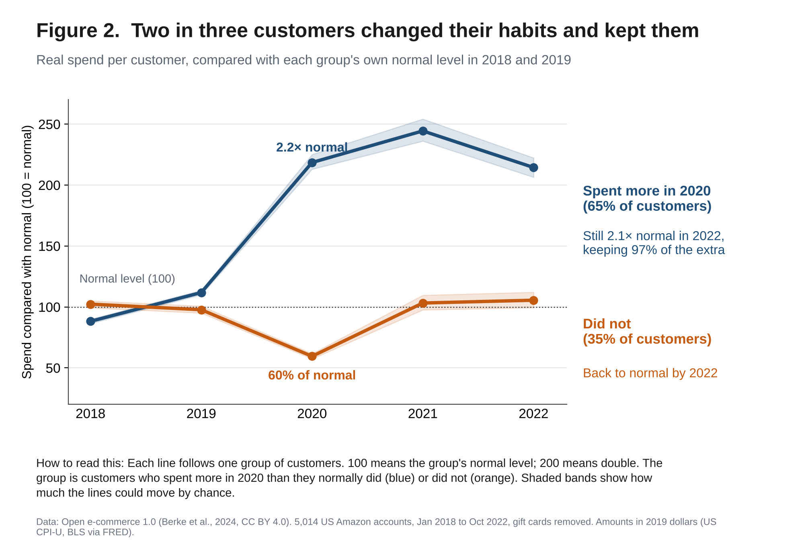
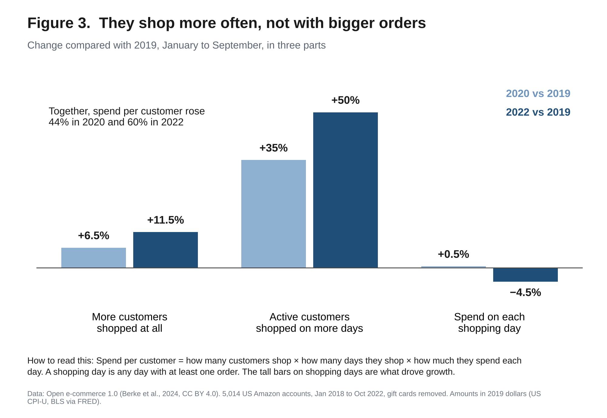
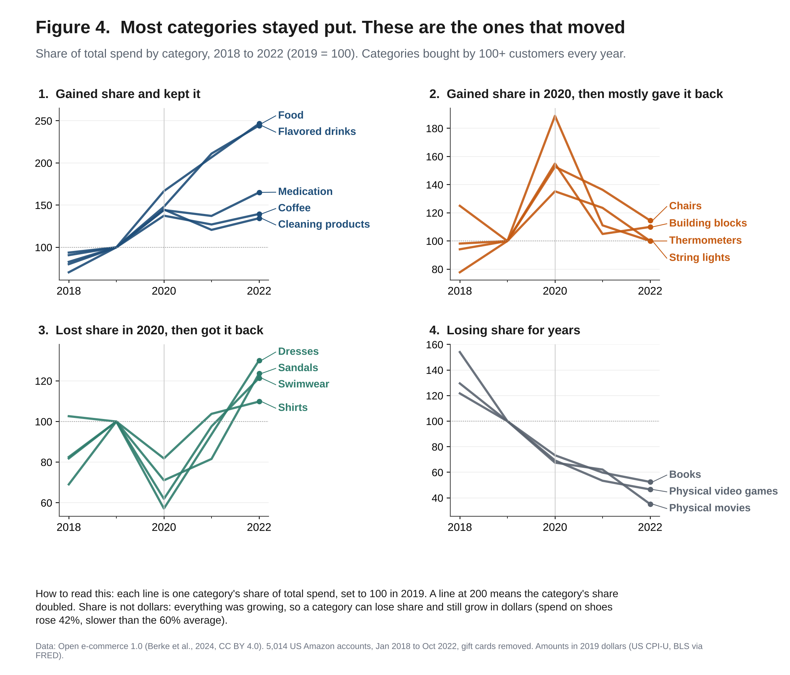
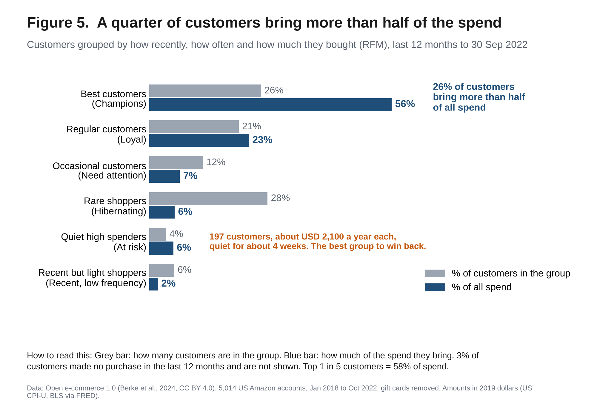

# Did the online shopping boom after 2020 last?

*What 5,014 real US Amazon accounts bought between 2018 and 2022*

**The short answer.** Mostly yes. The average customer still spends about 50–60% more than in 2019, even after taking out higher prices. But much of that growth was already under way before COVID. What COVID changed is how often people shop: about two in three customers started shopping more often in 2020 and kept doing it.

- **+60%**: how much more the average customer spent in 2022 than in 2019, after taking out inflation (USD 846 to USD 1,352 for January–September). About +50% if the group is matched to US adults by age and gender.
- **2 in 3**: customers spent more than usual in 2020, and they kept 97% of that extra spending through 2022.
- **8 in 10**: parts of the growth came from shopping more often, not from bigger orders.

## The data

Real purchase histories of 5,014 US Amazon accounts, shared with their owners' consent. About 1.7 million purchases from January 2018 to October 2022, with gift cards removed. All amounts are in 2019 dollars, adjusted with the US Consumer Price Index, so rising prices are not counted as growth. Every year is compared on January–September so the periods match.

## 1. Spending was already climbing before COVID

From 2018 to 2019, the average customer's spending grew about 13%. If that pace had simply continued, 2022 would have been about 43% above 2019. Actual spending was about 11% above that path, a gap that could be ordinary ups and downs. COVID's push was biggest in 2021 (38% above the path) and mostly faded by 2022.

*What it means: plan for the long-run climb, not for the 2021 peak.*



## 2. Two in three customers changed their habits and kept them

About 65% of customers spent more in 2020 than they normally did in 2018–2019, roughly 2.2 times their usual level. By 2022 they were still at about 2.1 times, keeping 97% of the extra. The other third spent less in 2020 (about 60% of normal) and were back to normal by 2022.

*What it means: for most of these customers it is a lasting change, not a one-time spike.*



## 3. They shop more often, not with bigger orders

Think of a corner shop: sales depend on how many people come in, how often they come, and how much they spend each visit. Here the visits went up. Compared with 2019, the average active customer shopped on about 35% more days in 2020 and about 50% more days in 2022 (a shopping day is any day with at least one order). The share of customers who shopped at all also grew, by 6.5% and 11.5%. Spend per shopping day did not rise: flat in 2020 and about 4.5% lower in 2022.

*What it means: getting customers to come back is worth more than pushing bigger orders.*



## 4. What people buy barely changed

Here we look at each category's share of total spend. 157 of the 213 categories we could track reliably look the same as before (together they cover about 57–60% of spend that has a category). The ones that moved:

- **Gained share and kept it:** medication, coffee, cleaning products, food, flavored drinks, snacks, chocolate, puzzles, lamps. Food and drink grew the most: spend per customer is 3 to 4 times its 2019 level.
- **Gained share in 2020, then mostly gave it back:** chairs, building blocks, thermometers, string lights.
- **Lost share in 2020, then got it back:** dresses, shirts, swimwear, sandals.
- **Losing share for years:** books, physical movies, physical video games. Spend on these is genuinely lower than in 2019.

A smaller share does not always mean less spending. Everything was growing, so shoes, backpacks and boots took a smaller slice of the total, but spend on shoes still rose 42%, just slower than the 60% average.

*What it means: stock up on staples, be careful with spike items, rebuild going-out apparel, and treat books and physical media as a shrinking business.*



## 5. A small group carries most of the spend

The top 1 in 5 customers account for about 58% of spend. The "Champions", the 26% who bought most recently, most often and spent the most, account for 56%. About 200 high-value customers (typically about USD 2,100 a year, roughly one shopping day a week) have gone quiet for about a month. They are the best group to win back. About 1 in 4 customers shop only about once every couple of months and bring about 6% of spend, so low-cost, automated contact is enough.

*What it means: protect the top group, chase the quiet high spenders, and don't overspend on the rest.*



## What I would do

- **E-commerce leadership:** set targets on the long-run trend and protect shopping frequency.
- **Category managers:** keep investing in staples, avoid over-stocking spike items, rebuild going-out apparel.
- **Marketing and CRM:** look after the top group, win back the quiet high spenders, automate contact for the rest.
- **Customers benefit from:** reliable stock of what they now buy regularly, and fewer irrelevant offers.

## How I checked this

I re-ran the main numbers 1,000 times on random re-draws of the customers to see how much they could move by chance, and again after removing gift cards, unusually large orders, and after matching the group to US adults by age and gender. Spend is up 50–60% in every version. Because 213 categories were tested at once, category labels use a stricter test, so fewer are flagged by luck.

## What this can't tell you

These are US accounts that had been shopping on Amazon since 2018, so there are no new customers, and some accounts are shared by a household. The group skews young and well educated. There are no margin or cost numbers, so the advice stops at demand. The pre-COVID trend comes from two years of data, so read the results as a range. The findings fit the COVID period but don't prove COVID caused them.

## Run it yourself

1. Install Python 3.10 or newer, then `pip install -r requirements.txt`.
2. Download `amazon-purchases.csv` and `survey.csv` from the dataset page (link below) and put them in the `data/` folder. The raw data is not included in this repository.
3. Open `notebook/shopping_after_covid.ipynb` and run it from top to bottom. It writes the tables to `results/` (a few minutes).
4. Run `python scripts/make_figures.py` to draw the figures in `figures/`.

```
notebook/   the analysis, step by step
scripts/    draws the figures from the tables
results/    the tables behind every number above (aggregated only)
figures/    the five figures
data/       put the two downloaded files here (not included)
```

## Data and credits

- Data: Berke, A., Calacci, D., Mahari, R., Yabe, T., Larson, K., & Pentland, S. (2024). Open e-commerce 1.0, five years of crowdsourced U.S. Amazon purchase histories with user demographics. *Scientific Data*, 11, 491 (CC BY 4.0). Article: https://doi.org/10.1038/s41597-024-03329-6. Dataset: https://doi.org/10.7910/DVN/YGLYDY. The data is shared for research and must not be used to identify participants. Nothing in this repository describes a single person.
- Inflation: US Bureau of Labor Statistics, Consumer Price Index for All Urban Consumers (CPIAUCSL), via FRED.

## About

Made by Muhammad Faskul Fatan, Business Analyst. [LinkedIn](https://www.linkedin.com/in/muhammad-faskul-fatan/)
